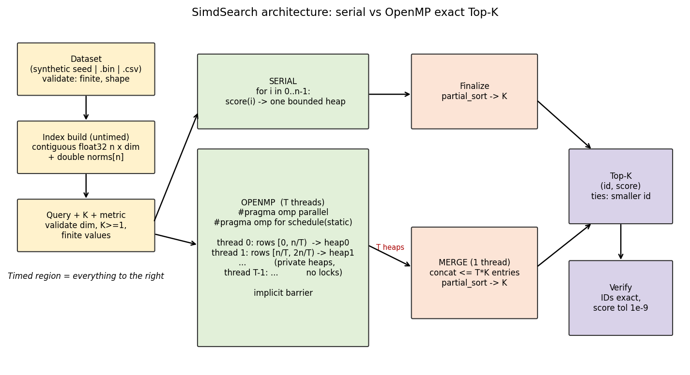
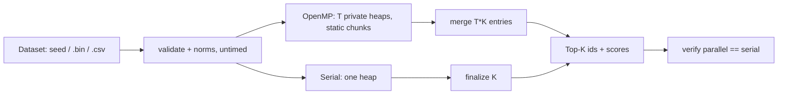
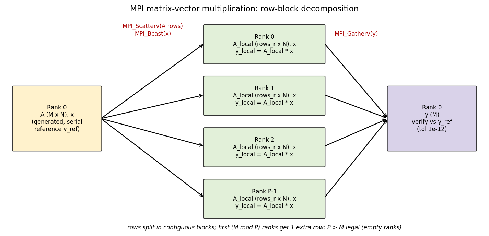
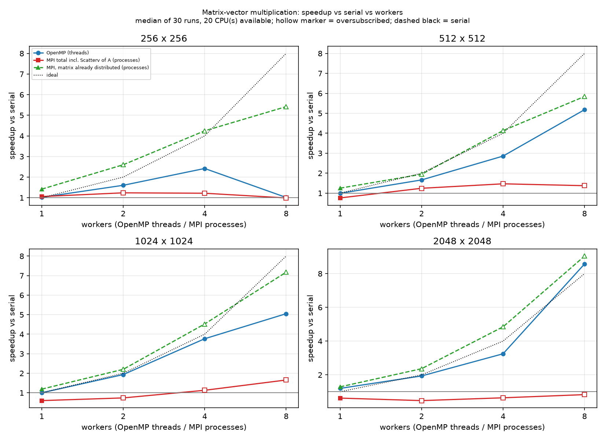
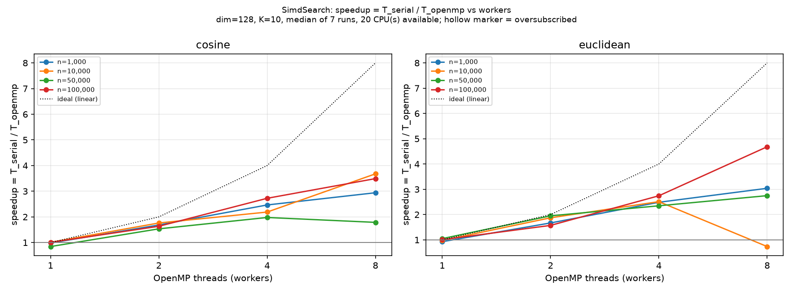

# Assignment 8: Comparative Study of OpenMP and MPI with HPC Mini-Project

**Mini-project:** SimdSearch, a parallel high-dimensional similarity search engine (AI / data-science category)
**Required experiment:** matrix-vector multiplication in serial, OpenMP and MPI

> **Read this first: the single most important limit of the evidence.**
> All measurements in this report were taken on a virtual machine that exposes **one CPU core** (`results/*_meta.json`).
> On one core no parallel speedup is physically possible, so **this report contains no demonstrated parallel scaling**.
> What the measurements *do* establish: every implementation is **correct** (all 292 benchmark rows verified, all 7 test suites pass),
> the OpenMP runtime overhead at one thread is negligible, and the cost of MPI data distribution is large and measurable.
> Multi-core numbers are marked **PENDING** below, with the exact commands to produce them. Nothing here is estimated or invented.

Table of contents: A Problem · B Algorithms · C Implementation · D Methodology · E Results · F OpenMP vs MPI · G Decision exercise · H Conclusion · I Reflection questions · J Group work split · K Verification status & pending experiments

---

## A. Problem definition

### A.1 SimdSearch

**Problem.** Given a dataset `D` of `n` vectors in `R^d`, a query `q`, an integer `K` and a metric, return the `K` vectors of `D` most similar to `q`, with their IDs and scores, *exactly* (no approximation).

* Cosine similarity: `cos(v,q) = (v.q) / (|v| |q|)`, ranked **descending** (1 = same direction).
* Euclidean distance: `|v-q|_2`, ranked **ascending** (0 = identical).

**Motivation.** Nearest-neighbour search is the inner loop of recommendation engines, semantic/text search over embeddings, retrieval-augmented generation, image retrieval, k-NN classification and clustering. Even when production systems use approximate indexes (HNSW, IVF, PQ), an exact brute-force scan is the ground truth they are evaluated against, and for modest `n` it is the fastest correct option.

| | |
|---|---|
| Inputs | dataset (`n x d`, float32; synthetic by seed, or `.bin`/`.csv` file), query (`d`), `K`, metric, thread count |
| Outputs | `K` pairs `(id, score)` in rank order; tie-break = smaller `id` |
| Work | `n*d` multiply-adds (about `2nd` flops) + selection; independent per vector |
| Memory | `4nd` bytes for the dataset + `8n` bytes of norms; streamed once per query |

### A.2 Matrix-vector multiplication

`y = A x`, `A` is `M x N` (doubles), `x` has `N` entries, `y[i] = sum_j A[i][j] x[j]`. It is the building block of iterative solvers, PageRank, neural-network layers and power iteration. Work `2MN` flops over `8MN` bytes of matrix data: about 0.25 flop/byte, so it is **memory-bandwidth bound**, which strongly shapes the results below.

---

## B. Algorithms

### B.1 SimdSearch, serial

```
function SEARCH_SERIAL(D, q, K, metric):
    validate(D, q, K)                          # K>=1, |q|=d, all finite;  K = min(K, n)
    qd <- double(q);  qnorm <- sqrt(sum qd^2)
    heap <- empty bounded heap, capacity K     # front = WORST kept entry
    for i in 0 .. n-1:
        key <- score_key(i)                    # cosine: similarity | euclid: -(squared distance)
        if heap.size < K:            push (key,i)
        else if (key,i) better than heap.front:  replace front with (key,i)
    sort heap by (key desc, id asc);  convert euclid keys with sqrt
    return heap
```

`score_key` for cosine returns 0 if either norm is 0; otherwise `dot/(norm_i*qnorm)` clamped to [-1,1]. Euclid ranks by squared distance (sqrt is monotonic) and applies `sqrt` once at the end. Both metrics use one "larger key is better" comparator, so there is a single total order: `key` descending, then `id` ascending.

### B.2 SimdSearch, OpenMP

```
function SEARCH_OPENMP(D, q, K, metric, T):
    validate(...);  prepare qd, qnorm, K
    allocate T heaps (capacity K each, cache-line aligned)        # before the parallel region
    parallel region with T threads:
        mine <- heaps[thread_id]                                   # private, no locks
        omp for schedule(static):                                  # contiguous block of ~n/T vectors per thread
            for i in my block: mine.push(score_key(i), i)
    # implicit barrier
    candidates <- concatenation of the T heaps                     # at most T*K entries
    partial_sort(candidates, K) by the same total order
    return top K
```

**Work decomposition.** Vectors are independent, so the loop is embarrassingly parallel; the data parallelism is over the `n` index. **Data dependencies:** none between iterations. The only shared state is read-only (dataset, query, norms). The only "reduction" is the Top-K selection, handled by thread-private heaps instead of a shared structure.
**Synchronization:** one implicit barrier at the end of the parallel region plus the serial merge of `T*K` entries (`O(TK log K)`, negligible for `TK << n`). No locks, atomics or critical sections in the hot loop.
**Why correct:** the global Top-K is contained in the union of the local Top-Ks (any global winner is a winner within its own chunk). Because the order is total (ties broken by `id`), the result does not depend on how work was split.
**Load balancing:** every vector costs the same `O(d)`; static scheduling gives the least overhead. Heap insertions are slightly data dependent but rare (`~K ln(n/K)` expected for random order).
**Memory behaviour:** each thread streams its own slice of the dataset exactly once; heaps are padded to 64 bytes to avoid false sharing.

Architecture / flow diagram: 



### B.3 Matrix-vector, serial and OpenMP

```
SERIAL:                                         OPENMP:
for i in 0..M-1:                                parallel for schedule(static) over i in 0..M-1:
    y[i] = sum_j A[i,j]*x[j]  (j ascending)         y[i] = sum_j A[i,j]*x[j]  (same row kernel)
```

Rows are independent: each thread owns a disjoint set of `y[i]`, no reduction, no race. The summation order within a row is fixed, so serial and OpenMP results are **bit-identical** (max relative error 0 in every run).

### B.4 Matrix-vector, MPI (distributed memory)

```
rank 0 holds A (MxN) and x
counts[r] = M/P + (r < M mod P ? 1 : 0)             # contiguous row blocks, sizes differ by <= 1
MPI_Scatterv(A, counts*N) -> A_local on every rank   # rank r receives counts[r] rows
MPI_Bcast(x)                                         # every rank needs the whole vector
y_local = A_local * x                                # same row kernel, no communication
MPI_Gatherv(y_local) -> y on rank 0
```



**Communication volume:** `Scatterv` moves `(P-1)/P * 8MN` bytes out of rank 0, `Bcast` moves `8N` bytes (tree, `O(log P)` steps), `Gatherv` moves `8M` bytes. Compute per rank is `2MN/P`. Scatter volume is the same order as the matrix itself, which is why a one-shot distributed multiply rarely beats a local one on a single node. **Edge cases handled and tested:** `P > M` (ranks with zero rows), `P = 1`, `M` not divisible by `P`, zero/overflowing dimensions (all ranks throw the same exception, so no deadlock), per-rank blocks above MPI's `int` count limit.

---

## C. Implementation

### C.1 Map of the code

| Component | File | Notes |
|---|---|---|
| Data generation | `part1_simdsearch/src/dataset.cpp` | Own SplitMix64 PRNG: identical data on every compiler/OS (the standard `<random>` distributions are implementation-defined). Row `i` is derived from `(seed, i)`. |
| File I/O | `src/io.cpp` | Binary `SIMDSRC1` and CSV; checks magic, exact size, overflow, ragged rows, non-numbers, NaN/Inf |
| Search | `src/search.cpp` | `TopK` bounded heap, `CosineKey`/`EuclidKey` functors, `search_serial`, `search_openmp`, independent oracle `search_reference` (tests only) |
| CLI | `src/main_cli.cpp` | `search`, `generate`, `info`; text and `--json` |
| Benchmark | `src/bench_search.cpp` | grid runner, verification before recording, CSV + metadata |
| Matvec kernels | `part2_matvec/src/matvec.cpp` | one `dot_row` kernel shared by serial, OpenMP and MPI |
| Matvec MPI | `src/matvec_mpi.cpp`, `src/matvec_mpi_main.cpp` | class `MpiMatVec` (Scatterv / Bcast / Gatherv), phase timing, oversubscription check |
| Tests | `*/tests/*.cpp` | custom dependency-free harness |

### C.2 Design decisions worth explaining in a viva

* **Contiguous layout:** one `std::vector<float>` of `n*d` (vector `i` at offset `i*d`): sequential streaming, hardware-prefetch friendly, no pointer chasing.
* **Types:** float32 storage halves memory traffic versus double; **all arithmetic accumulates in double** (`static_cast<double>(v[j]) * q[j]`) so sums of up to thousands of terms do not lose precision. Matvec uses doubles throughout.
* **Norms are an "index build" product:** `norms[i]` is computed once, outside every timed region, and used identically by serial and OpenMP, so both do equivalent per-query work. This is stated in the timed-region definition (section D).
* **Zero-norm convention:** cosine similarity involving a zero vector is defined as `0`. It never produces NaN, and ranking stays a total order. Tested for zero data vectors and for a zero query.
* **Thread-local heaps + one merge** instead of a shared heap behind a lock: a lock taken on every improvement would serialize the loop. Heaps are allocated before the parallel region so the hot loop does no allocation.
* **Deterministic ties:** total order `(key desc, id asc)`; duplicate-vector tests verify the K smallest IDs are returned for 1-8 threads.
* **`-ffp-contract=off`:** stops the compiler from fusing multiply-adds differently in different translation units, so serial/OpenMP/MPI arithmetic is identical and the correctness tolerance can be tight.
* **`omp_set_dynamic(0)` and a verified team size:** benchmarks check that the runtime really gave the requested number of threads; otherwise the row is rejected.
* **SIMD honesty.** Compiling the hot loops with `-O3 -fopt-info-vec` and inspecting the assembly: the SimdSearch scoring loops use scalar SSE2 (`mulsd/addsd/subsd`) only; the matvec dot loop uses 128-bit packed multiplies (`mulpd`) but its additions stay strictly ordered and scalar, because vectorizing a floating-point reduction needs reassociation (`-ffast-math` or `omp simd reduction`), which I deliberately did not enable. **No explicit SIMD is implemented, so no SIMD speedup is claimed.** It is listed as future work (H).

### C.3 Build and sample runs

See `README.md` for exact commands. Sample (real) output for the 12-vector CSV example is in `data/sample_output_*.txt`, and `data/sample_output.json` shows the machine-readable form used by the dashboard.

---

## D. Experimental methodology

### D.1 Environment (from `results/*_meta.json`)

| Item | Value |
|---|---|
| CPU | Intel Xeon @ 2.10 GHz (virtual machine), **1 logical CPU available to the process** |
| RAM | about 4 GB |
| Compiler / flags | GCC 13.3.0, C++17, `-O3 -DNDEBUG -fopenmp -ffp-contract=off`, CMake build type Release |
| OpenMP | version macro 201511 (OpenMP 4.5), `OMP_*` variables unset |
| MPI | Open MPI 4.1.6 (Debian package), launcher `mpiexec` of the same version |
| Clock | `std::chrono::steady_clock` (monotonic); MPI: `MPI_Wtime` |

### D.2 Test configurations

| Experiment | Configuration actually run |
|---|---|
| SimdSearch | n in {1,000; 10,000; 50,000; 100,000}, d in {32, 64, 128}, K in {10, 100}, metrics {cosine, euclidean}, threads {1, 2, 4, 8}, seed 42, query seed 7919, 7 timed runs after 2 warm-ups (`configs/simdsearch_full.cfg`) |
| Matvec | N x N for N in {256, 512, 1024, 2048}; OpenMP threads {1,2,4,8}; MPI processes {1,2,4,8}; seed 42; 30 timed runs after 5 warm-ups (`configs/matvec_assignment.cfg`) |
| Oversubscription | The machine has 1 CPU, so 2/4/8 workers were run with `--allow-oversubscribe`; **144 of 240 SimdSearch rows and all matvec rows with workers>1 are flagged `oversubscribed=1`** |

### D.3 Timing methodology

* Identical dataset, query and seed for serial and parallel variants; the dataset is generated (or loaded) once per `(n,d)` and is **never** inside a timed region. Norm computation, file I/O and UI are also excluded.
* The timed region of SimdSearch is the **complete search**: query preparation, scoring, bounded selection, thread-local heap allocation, merge and final sort.
* Matvec timed region: OpenMP/serial = the multiply. MPI `mpi_full` = Scatterv(A) + Bcast(x) + multiply + Gatherv(y); `mpi_resident` = the same without Scatterv (A already distributed). A barrier before each run (outside the clock) gives all ranks a common start; the reported time is the **maximum over ranks**.
* **Statistic:** the **median** of the timed repetitions is the headline value; min, mean and stddev are also stored in every CSV row so noise is visible.
* `Speedup = T_serial / T_parallel`; `Efficiency = Speedup / workers`. For SimdSearch the serial baseline is `search_serial` measured in the same process, on the same data. For matvec the baseline is the serial time from `bench_matvec_omp` (a separate process, so idle MPI ranks cannot disturb it). **Threads (OpenMP) and processes (MPI) are never mixed**; every CSV row carries `worker_type`.

### D.4 Correctness validation (before any timing is accepted)

* SimdSearch: IDs must match exactly and in order; scores within `1e-9 * (1+|score|)`. In practice the maximum score difference observed in all 240 rows is 0.
* Matvec: max relative error `|y - y_ref| / max(1,|y_ref|) <= 1e-12` versus the serial result; the serial result is itself checked against a long-double oracle. Observed error: 0 (identical arithmetic).
* Rows that fail verification are never written to the CSV, and the plotting scripts assert that every row is verified.
* Independent check: `scripts/crosscheck_numpy.py` recomputes Top-K with NumPy (different language, different code path) for several queries, both metrics, and compares with the C++ binary (IDs identical, score differences below 1e-9: PASS on 1,000x32 and 20,000x100 datasets).

---

## E. Results and interpretation

All figures are in `results/figures/`; tables in `results/*_summary.md`; raw data in `results/*.csv`. They are regenerated by `scripts/plot_*.py` and contain only recorded data.

### E.1 Graphs produced

| Required graph | File |
|---|---|
| Workers vs time, SimdSearch | `simdsearch_time_vs_workers.png` |
| Workers vs speedup | `simdsearch_speedup_vs_workers.png` |
| Workers vs efficiency | `simdsearch_efficiency_vs_workers.png` |
| Dataset size vs time / speedup | `simdsearch_time_vs_size.png`, `simdsearch_speedup_vs_size.png` |
| Thread-count scaling overview, dimension effect | `simdsearch_scaling_overview.png`, `simdsearch_time_vs_dim.png` |
| Matvec OpenMP vs MPI: time / speedup / efficiency vs workers | `matvec_{time,speedup,efficiency}_vs_workers.png` |
| Matvec size vs time / speedup | `matvec_time_vs_size.png`, `matvec_speedup_vs_size.png` |
| MPI phase breakdown | `matvec_mpi_phase_breakdown.png` |




### E.2 Matrix-vector summary (measured; `*` = oversubscribed on 1 CPU, not valid scaling evidence)

Cells: time (speedup vs serial). Full table with efficiencies: `results/matvec_summary.md`.

| N | serial (ms) | OpenMP T=1 | OpenMP T=8* | MPI total P=1 | MPI total P=8* | MPI resident P=1 | MPI resident P=8* |
|---|---|---|---|---|---|---|---|
| 256 | 0.036 | 0.036 (0.99x) | 0.070 (0.51x) | 0.068 (0.52x) | 0.161 (0.22x) | 0.056 (0.64x) | 0.050 (0.71x) |
| 512 | 0.165 | 0.166 (0.99x) | 0.207 (0.80x) | 0.457 (0.36x) | 0.526 (0.31x) | 0.269 (0.61x) | 0.234 (0.71x) |
| 1024 | 0.750 | 0.773 (0.97x) | 0.905 (0.83x) | 1.923 (0.39x) | 1.769 (0.42x) | 0.846 (0.89x) | 0.831 (0.90x) |
| 2048 | 3.030 | 2.982 (1.02x) | 3.125 (0.97x) | 5.872 (0.52x) | 6.707 (0.45x) | 3.067 (0.99x) | 3.218 (0.94x) |

### E.3 SimdSearch summary (dim=128, K=10; full grid in `results/simdsearch_summary.md` and `results/simdsearch_summary_full.csv`)

| metric | n | serial (ms) | OpenMP T=1 (speedup) | T=8* (speedup) |
|---|---|---|---|---|
| cosine | 1,000 | 0.123 | 0.132 (0.94x) | 0.225 (0.55x) |
| cosine | 10,000 | 1.065 | 0.991 (1.07x) | 1.315 (0.81x) |
| cosine | 50,000 | 5.337 | 5.399 (0.99x) | 5.407 (0.99x) |
| cosine | 100,000 | 12.45 | 8.610 (1.45x) | 12.26 (1.02x) |
| euclidean | 1,000 | 0.147 | 0.152 (0.97x) | 0.218 (0.67x) |
| euclidean | 10,000 | 1.074 | 1.075 (1.00x) | 1.091 (0.99x) |
| euclidean | 50,000 | 5.444 | 5.557 (0.98x) | 5.553 (0.98x) |
| euclidean | 100,000 | 9.877 | 9.523 (1.04x) | 10.52 (0.94x) |

### E.4 Observations **confirmed by these experiments**

1. **Correctness of all variants.** All 240 SimdSearch rows and 52 matvec rows passed verification; ctest 7/7 passed, including genuine multi-process MPI runs with 1, 2, 3, 4 and 8 ranks (with `--expect-np` proving the world size).
2. **OpenMP overhead at one thread is negligible.** Matvec OpenMP T=1 runs at 0.97-1.02x of serial. For SimdSearch the median T=1 "speedup" over all 48 configurations is 0.98.
3. **Measurement noise on this VM is substantial, and it bounds what can be concluded.** The same-work T=1 comparison scatters between 0.67x and 2.29x across individual configurations. The anomalous **1.45x at n=100,000 (cosine)** is *not* a parallel gain: T=1 and serial do identical work on the same core. The serial row there has a 24% relative standard deviation (its runs ranged from 8.9 to over 12 ms; its minimum, 8.90 ms, is about the same as OpenMP's 8.47 ms), so its median is inflated by interference from the shared host. Differences of roughly ±10% (and any single-cell result like this one) should be treated as noise. I report the data unmodified.
4. **Oversubscription yields no speedup, as expected, and hurts small problems most.** With 8 threads on 1 core, SimdSearch at n=1,000 drops to 0.55x (cosine) and 0.67x (Euclidean) of serial: the extra per-call cost of creating/synchronizing 8 threads (about 0.1 ms here: 0.225 ms vs 0.123 ms for cosine) is as large as the useful work itself. At n>=50,000 the overhead is amortized (about 0.94-1.02x). Parallel execution being *slower* for small inputs is reported as observed.
5. **MPI data distribution is expensive, and it dominates the one-shot cost.** At P=1 (no network, just a local copy through MPI) `mpi_full` runs at only 0.36-0.52x of serial. For N=2048 the Scatterv phase alone takes 2.81 ms of 5.87 ms (48%), roughly as much as the entire multiply (3.06 ms). Once the matrix is already resident (`mpi_resident`), P=1 reaches 0.89-0.99x for N>=1024, but still only 0.61-0.64x for N<=512, where fixed per-call costs (barrier-synchronized start, Bcast, Gatherv) are comparable to the ~0.04-0.2 ms of compute.
6. **The serial matvec is memory/latency limited.** Effective matrix streaming rate (`8N^2 / t`) is 14.7, 12.7, 11.2 and 11.1 GB/s for N = 256..2048, and it falls as the matrix leaves cache (0.5 MB to 32 MB). On a multi-core machine this predicts bandwidth-limited scaling (see E.5).
7. **Oversubscribed MPI phase timings measure the OS scheduler, not the network.** At P=8 on one core the per-rank compute phase falls to 0.43 ms (N=2048; about 1/7 of the P=1 value, because each rank has 1/8 of the rows), while Bcast and Gatherv inflate to 5.1 ms and 1.6 ms: ranks wait for the others to be scheduled. These collective times must not be interpreted as communication cost.

### E.5 Expected behaviour **not confirmed here** (architectural reasoning; to be tested on a multi-core machine)

* SimdSearch scoring is compute-heavy with sequential streaming (about 4 bytes read per 2 flops). Expect near-linear OpenMP speedup up to the point where memory bandwidth saturates (several cores per memory controller), then diminishing returns; speedup improves with n and with d because fork/join overhead is amortized. Small n (about 1,000) should stay overhead-dominated.
* Matvec OpenMP: a bandwidth-bound kernel typically saturates at a fraction of the core count; efficiency then falls even with no software overhead.
* Matvec MPI on one node: expect `mpi_resident` to track OpenMP (same arithmetic, separate address spaces) and `mpi_full` to remain slower because Scatterv adds an `O(MN)` copy through rank 0; the gap shrinks relative to compute only if the matrix is reused many times.
* On multiple nodes, the Scatterv/Bcast/Gatherv cost moves from memory-copy cost to network latency/bandwidth, while the number of cores that can contribute grows far beyond one node: the regime where MPI is the only option.
* Load balance: SimdSearch and matvec have uniform work per item, so static partitioning is expected to balance well; MPI row counts are provably balanced to within one row (tested for P up to 16, including P > rows).

### E.6 Bottlenecks, limitations and improvements

* **Limitations of this study:** a single-core VM (no scaling evidence, noisy timing), a single seed per configuration, no thread pinning, uniform random data (real embeddings have structure that affects heap-update frequency only slightly), single query per timing (batching queries would amortize overhead and raise arithmetic intensity).
* **Possible improvements:** explicit SIMD / `#pragma omp simd` with several accumulators; block queries so a cache-resident tile of vectors is reused (matrix-matrix form, much better flop/byte); `float` accumulation or int8 quantization for speed (trading exactness); NUMA-aware first-touch allocation and `OMP_PROC_BIND`; for MPI, distribute data once (resident), overlap communication with compute using non-blocking collectives, or use hybrid MPI+OpenMP (H).

---

## F. OpenMP versus MPI

| Aspect | OpenMP | MPI |
|---|---|---|
| Programming model | Compiler directives on shared-memory fork-join parallelism (incremental parallelization of serial code) | Explicit message passing library (SPMD; the program is restructured around data distribution) |
| Unit of execution | Threads in one process | Processes (ranks), each with its own address space; can span nodes |
| Memory model | Shared address space; data is visible to all threads (races are possible and must be avoided) | Distributed: private memory per rank; data moves only by explicit messages |
| Communication | Implicit through shared memory (loads/stores) | Explicit: point-to-point (`Send/Recv`) and collectives (`Scatterv`, `Bcast`, `Gatherv`, `Reduce`...) |
| Synchronization | Barriers, critical/atomic, locks, reductions; implicit barrier at the end of worksharing loops | Blocking/collective calls synchronize implicitly; explicit `MPI_Barrier`; no shared data to lock |
| Programming complexity | Low to start (this project: two pragmas); hard bugs are data races and false sharing | Higher: manual decomposition, counts/displacements, deadlock avoidance, edge cases (`P > rows`) (this project: the OpenMP wrapper is 17 lines; the MPI class plus header is about 130 lines, for the same kernel) |
| Communication overhead | Very low (cache coherence, thread fork/join: microseconds) | Higher: copies, latency + bandwidth cost per message; measured here: scatter was 48% of the N=2048 one-shot time even with P=1 |
| Shared-memory scalability | Excellent within one node, limited by cores and memory bandwidth; NUMA effects | Works within a node too (shared-memory transport) but pays the copy/serialization cost; often a bit slower than OpenMP in-node for the same problem |
| Multi-node capability | **None** by itself | **Yes**: the standard for clusters and supercomputers |
| Suitable applications | Loop-level parallelism on one workstation/server: image processing, parallel preprocessing, per-vector search (SimdSearch), dense kernels that fit one node | Domain decomposition and data that exceed one node: CFD/weather/molecular dynamics, large linear algebra, distributed search; also hybrid MPI+OpenMP |

**What the experiments support and what they do not.** *Supported by measurement:* MPI needed far more code and had a large data-distribution overhead (E.4 item 5), while OpenMP added no overhead at one thread (item 2) and needed two pragmas. *Architectural expectations not verified here:* shared-memory scaling advantage of OpenMP at 8+ cores and multi-node superiority of MPI (E.5).

---

## G. Decision-making exercise

| Scenario | Choice | Justification |
|---|---|---|
| Image processing on a single multicore workstation | **OpenMP** | Pixels/rows/tiles are independent, the image fits in shared memory, no messages needed; one `parallel for` over rows with static or dynamic schedule gives most of the benefit at a fraction of the development effort. (GPU offload is an alternative, out of scope.) |
| Large matrix computation across multiple HPC nodes | **MPI** (typically with a 2-D block-cyclic distribution, e.g. via ScaLAPACK/PETSc) | The matrix may not fit one node's memory and needs more cores/bandwidth than one node has; MPI is the only model that spans nodes. Keep the matrix resident to avoid repeated scatter cost (E.4 item 5). |
| Scientific simulation requiring inter-node communication | **MPI** | Domain decomposition with halo (ghost-cell) exchanges every time step; neighbour communication (`Sendrecv`/non-blocking), reductions for global quantities; scales across thousands of nodes. |
| Parallel preprocessing on a multicore CPU | **OpenMP** | Typically independent per-record transformations (normalization, feature extraction, norm computation) on data already in memory: loop parallelism with trivial synchronization. |
| HPC application needing both intra-node and inter-node parallelism | **Hybrid MPI + OpenMP** | One MPI rank per node (or per NUMA domain) for inter-node domain decomposition, OpenMP threads inside the rank for the cores: fewer ranks means less halo/replication memory and fewer messages, while avoiding intra-node message copies. |

---

## H. Conclusion and future scope

**Findings.** (1) Exact Top-K similarity search parallelizes cleanly with thread-private bounded heaps and a single `T*K` merge; the parallel results are identical to the serial ones for every tested thread count, with deterministic tie-breaking. (2) The serial/OpenMP/MPI matrix-vector versions agree exactly. (3) On the available single-core machine the data show that OpenMP has negligible overhead, that oversubscription gives no speedup and hurts small problems, and that MPI's distribution cost dominates a one-shot distributed matvec; they do **not** show parallel scaling, which remains **pending** on multi-core hardware (section K). (4) Careful benchmarking practices (verification before timing, flagged oversubscription, noise statistics) mattered: they exposed an apparent 1.45x "speedup" as noise and a silently broken MPI launcher.

**Realistic next steps.**

* *SIMD:* several independent accumulators or `#pragma omp simd reduction(+:acc)` (with a documented tolerance), AVX2/AVX-512 intrinsics; verify with `-fopt-info-vec` and measure.
* *Batching queries* to turn the scan into a matrix-matrix product and reuse cached data (large gains in arithmetic intensity).
* *Approximate nearest neighbours:* IVF, HNSW or product quantization for sub-linear search, evaluated for recall against this exact engine.
* *Distributed search:* shard the dataset across MPI ranks, each rank returns its local Top-K, then a `Gatherv` + merge (`P*K` candidates): the same merge idea at cluster scale.
* *Hybrid MPI + OpenMP:* one rank per node, SimdSearch's OpenMP kernel inside each rank.

---

## I. Reflection questions

*The assignment's ten questions were not supplied with the request, so the ten below are derived from the topics it listed (observed OpenMP/MPI differences, communication overhead, synchronization overhead, non-linear speedup, model selection, bottlenecks, redesign for a larger cluster). **Map them to the numbering in your assignment sheet before submitting.***

1. **What differences between OpenMP and MPI did you observe while implementing the matrix-vector product?**
   OpenMP needed two pragmas around the existing loop and no data movement: threads read the same `A` and write disjoint `y[i]`. MPI required an explicit decomposition (counts/displacements with remainder handling), three collectives, per-rank buffers, and special cases (`P > M`, `P = 1`, invalid sizes without deadlock). The arithmetic kernel was shared, so results were bit-identical; the difference is almost entirely in data management and code volume.
2. **How large was the communication overhead of MPI?**
   Measured: at P=1, the one-shot MPI version ran at 0.36-0.52x of serial; for N=2048, `Scatterv` took 2.81 ms of 5.87 ms (48%), about as much as the multiply itself (3.06 ms). With the matrix already resident the overhead dropped to about 1% (N=2048) and 13% (N=1024) over serial, but stayed at 57-63% for N<=512 (fixed per-call costs dominate tiny work). (Network latency across nodes was not measured: single-node, single-core environment.)
3. **What synchronization overhead does each model have?**
   OpenMP: a fork/join and an implicit barrier per parallel region, no locks in our design because heaps/rows are private; measured cost shows up only for tiny problems (SimdSearch n=1,000 at 8 oversubscribed threads: 0.55-0.67x). MPI: collectives synchronize ranks implicitly; at P=8 oversubscribed, Bcast/Gatherv times (5.1/1.6 ms at N=2048) were dominated by waiting for other ranks to be scheduled.
4. **Why is speedup not linear (and not even above 1 here)?**
   Reasons in general: Amdahl's serial fraction (merge, validation), fork/join and communication costs, load imbalance, memory-bandwidth saturation (matvec streams 11-15 GB/s per core here), cache/NUMA effects. In *this* study the dominant reason is simpler: only **one CPU** was available, so workers time-share a core (no speedup possible) and the extra threads/ranks only add overhead. The observed non-ideal behaviour is therefore evidence of the overheads, not of scaling limits.
5. **How did problem size affect the benefit of parallelism?**
   Overhead is fixed per call, work grows with `n*d` or `N^2`. Observed: parallel overhead hurts most at n=1,000 (0.55x) and N=256, and fades at n>=50,000 / N=2048 (about 0.94-1.02x). Expected on multi-core hardware: benefit appears once work per thread greatly exceeds the fork/join cost (about 0.1 ms at 8 oversubscribed threads here; the true multi-core cost is a pending measurement).
6. **When would you choose OpenMP, and when MPI?**
   OpenMP for loop-level parallelism on one shared-memory node (preprocessing, image processing, per-vector search). MPI when data or compute exceed one node, or for domain-decomposed simulations. Hybrid when you need both (section G).
7. **What were the main bottlenecks?**
   Matvec: memory bandwidth (11-15 GB/s effective, arithmetic intensity about 0.25 flop/byte) and, for MPI, the scatter of `A`. SimdSearch: scalar, latency-bound dot-product reduction (strict-order double accumulation, no SIMD) and memory streaming for large `n*d`; the selection step is negligible (few heap updates).
8. **Why does correctness checking matter before comparing timings?**
   A faster wrong program is not a speedup. Here verification (exact IDs, scores within 1e-9; matvec within 1e-12) gates every timing row; mutation tests confirmed the test suite fails on injected bugs, and a world-size guard exposed that an MPI launcher mismatch had initially made multi-rank tests pass vacuously.
9. **How would you redesign the project for a larger cluster?**
   Shard the dataset across nodes (MPI ranks hold their shard resident, no per-query scatter); broadcast the query (`O(d)`), each rank runs the OpenMP kernel on its shard and returns a local Top-K; `Gatherv`/tree-reduce `P*K` candidates and merge; use one rank per NUMA domain with pinned threads; batch many queries per message to amortize latency; add an ANN index per shard for sub-linear search; use non-blocking collectives to overlap query broadcast with scanning. For matvec: 2-D block distribution to reduce per-rank communication from `O(N)` to `O(N/sqrt(P))`, resident matrix, overlapped halo/vector exchange.
10. **What were the limitations of your experiments, and how would you strengthen them?**
    One-core VM with noisy timing, so no scaling claims; single seed; no pinning. Strengthen by running `scripts/run_all.sh` on an 8+ core machine (and a 2-node cluster for MPI), multiple seeds, `OMP_PROC_BIND=close OMP_PLACES=cores`, more repetitions, and reporting confidence intervals; add the SIMD and query-batching variants.

---

## J. Suggested division of work for four students

| Student | Responsibility | Main deliverables |
|---|---|---|
| 1. Algorithms & SimdSearch core | Dataset generation, I/O, metrics, `TopK`, `search_serial`, `search_openmp`, input validation | `part1_simdsearch/src/{dataset,io,search}.cpp`, search unit tests, Section B.1-B.2 |
| 2. Matrix-vector (serial, OpenMP, MPI) | `matvec.cpp`, `MpiMatVec`, edge cases, MPI tests and launcher checks | `part2_matvec/`, Section B.3-B.4, MPI troubleshooting |
| 3. Benchmarking & analysis | Benchmark runners, CSV schema, metadata, plotting/summary scripts, running experiments on multi-core/cluster hardware | `bench_*.cpp`, `scripts/`, `results/`, Section D-E, pending experiments (K) |
| 4. Integration, dashboard & report | CMake, CLI, dashboard, README, report assembly, OpenMP-vs-MPI comparison and decision exercise, viva preparation | `CMakeLists.txt`, `main_cli.cpp`, `dashboard/`, `README.md`, Sections A, F-I |

Everybody should be able to explain the whole pipeline in the viva; cross-review each other's pull requests and run `ctest` before merging.

---

## K. Verification status and pending experiments

### K.1 What was actually run (in the development environment: 1 CPU, GCC 13.3, Open MPI 4.1.6)

| Check | Result |
|---|---|
| Build with `-Wall -Wextra`, Release, with MPI | clean (no warnings) |
| `ctest`: SimdSearch unit tests (11), matvec serial/OpenMP tests, MPI tests at np = 1, 2, 3, 4, 8 | **7/7 passed** (MPI tests oversubscribed on 1 CPU: valid for correctness, not timing) |
| Test sensitivity (mutation): injected a wrong MPI row-remainder and a reversed tie-break | the corresponding tests **failed**; code restored, all pass |
| NumPy independent cross-check (both metrics, several queries, K=10 and 50) | all PASS |
| Benchmarks: `scripts/run_all.sh` with oversubscription allowed | completed; 240 + 52 rows, all verified |
| Strict mode: oversubscribed counts skipped / MPI refused | observed (SKIP messages; exit code 3) |
| Dashboard | rendered and exercised headlessly with Streamlit's `AppTest` (both metrics, searches run through the real binary, no exceptions). **Not inspected in a real browser; no screenshots are included.** |
| Compiler vectorization report | scalar SSE2 in SimdSearch loops; partial packed multiplies in matvec (C.2) |

**A defect found during validation.** The first MPI test run (with the Ubuntu `mpich` package) passed at np=2..8 *vacuously*: its launcher and library were mismatched, so every process was a one-rank singleton. This was detected via a hello-world that printed `rank 0 of 1`, diagnosed (PMIx-linked `libmpich` vs Hydra), fixed by switching to Open MPI, and prevented from recurring by `--expect-np` / `--expect-procs` guards. All MPI results in this report come from real multi-rank runs.

### K.2 Not verified / pending

| Item | Status | How to produce the evidence |
|---|---|---|
| Parallel scaling of SimdSearch and matvec at 2/4/8 real cores | **PENDING** (needs >= 8 cores) | `scripts/run_all.sh` on an 8+ core machine (no oversubscription flag needed); copy `results/` into the report |
| MPI on more than one node | **PENDING** | `mpiexec -n 16 -hostfile hosts build/part2_matvec/matvec_mpi --config configs/matvec_assignment.cfg --expect-procs 16`; also run `PROCS="1 2 4 8 16"` |
| Thread pinning study | **PENDING** | `OMP_PROC_BIND=close OMP_PLACES=cores scripts/run_all.sh` vs unpinned |
| Large configuration (up to 1M x 512) | **PENDING** | `bench_search --config configs/simdsearch_large.cfg` (needs about 2.6 GB RAM) |
| Other compilers/OS (Clang, MSVC, macOS, Windows), MPICH | not tested | build instructions in README; only GCC 13 on Linux with Open MPI 4.1.6 was run |
| Explicit SIMD | not implemented | listed as future work |
